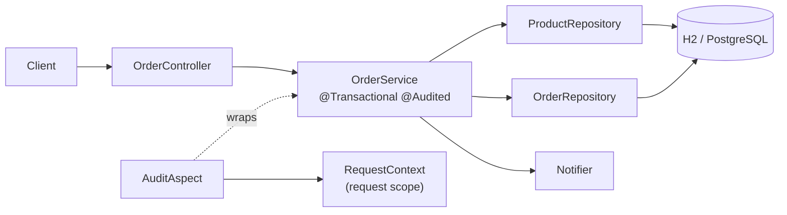

# Lab 02 

## Task 1
**1. What does the `<parent>` give you?**
The `<parent>` (spring-boot-starter-parent) provides default dependency management, plugin configuration, and a curated list of compatible library versions. This means you don't need to specify versions for most dependencies, which prevents version conflicts.

**2. Why do the starters have no `<version>`?**
Because the parent POM already defines the versions for all Spring Boot starters. It ensures all dependencies are compatible with the specific Spring Boot version you are using and reduces boilerplate code.

**3. What does `spring-boot-maven-plugin` do at package time?**
It repackages the standard `.jar` file into an executable "fat jar" (or uber jar). It bundles all the application's dependencies inside the jar and adds a manifest file so the jar can be run directly with `java -jar`.

**4. Why is the jar large?**
The jar is large because it contains the entire Spring Boot framework, Tomcat web server, and all the dependencies bundled inside it, so it can run on any machine without needing an external server or pre-installed libraries.

**5. Explain the condition evaluation report line:**
It says `DataSourceAutoConfiguration matched` because I added the JDBC and H2 dependencies. Spring Boot automatically detected that a database connection is needed, so it configured an in-memory H2 database for me without requiring any manual setup.

## Task 3 Answers

**1. Is there a Database and JdbcClient connection?**
Yes. Spring Boot automatically configured an H2 in-memory database. The `JdbcClient` is successfully injecting and executing SQL queries against it.

**2. Can you prove that the transaction rolls back?**
Yes. In the output, "Keyboard" was saved, but immediately after, an exception was thrown. The final database query showed only "Laptop" and "Mouse". This proves `@Transactional` rolled back the "Keyboard" insertion when the error occurred.

# Challeges 

<div align="center">

# 🛒 Shop: Orders API

**Spring Boot 4.1 · Java 21 · JdbcClient · H2 / PostgreSQL**

Place orders atomically, list them with pagination, cancel them and restore stock.

</div>

---

<div align="center">

## ▶️ Run

</div>

```powershell
.\mvnw.cmd spring-boot:run          # H2 in memory (profile "test", default)
.\mvnw.cmd clean verify             # all tests
docker compose up -d                # PostgreSQL for profile "prod"
.\mvnw.cmd spring-boot:run "-Dspring-boot.run.profiles=prod"
```

<div align="center">

## 🔌 API

| Method | Path | Result |
|---|---|---|
| POST | `/api/orders` | 201 · 400 invalid · 404 unknown · **409 no stock** |
| GET | `/api/orders?customerId=&status=&page=&size=` | `{content, page, size, totalElements}` |
| GET | `/api/orders/{id}` | order with lines |
| POST | `/api/orders/{id}/cancel` | 200 · **409 if not NEW** |

</div>

<div align="center">

## 🧱 Architecture

</div>



Package by feature: `order/`, `product/`, `customer/` (web → service → repository), plus `audit/`, `config/`, `common/`, `service/` (notifiers).

<div align="center">

## 🔄 Transaction boundary

</div>

The boundary is the **service method** `OrderService.place` (and `cancel`). Placing an order is several SQL statements (one stock update per line plus the order inserts) that must succeed or fail together. If a line has too little stock, `InsufficientStockException` rolls everything back and the client gets **409** with stock unchanged. A repository is too narrow (each statement would commit alone) and a controller too wide (it would hold the connection during JSON handling). Stock is updated with `... AND stock + :delta >= 0`, so concurrent orders cannot oversell.

<div align="center">

## ✅ Tests

| Level | Classes |
|---|---|
| Unit (no Spring) | `PricingTest`, `OrderServiceTest` |
| `@JdbcTest` | `ProductRepositoryTest`, `OrderRepositoryTest` |
| `@WebMvcTest` | `OrderControllerTest` |
| End-to-end (`RANDOM_PORT`) | `OrderEndToEndTest` |

**36 tests · 0 failures**

*The `prod` profile and `docker-compose.yml` are provided but were not run locally (no Docker).*

</div>