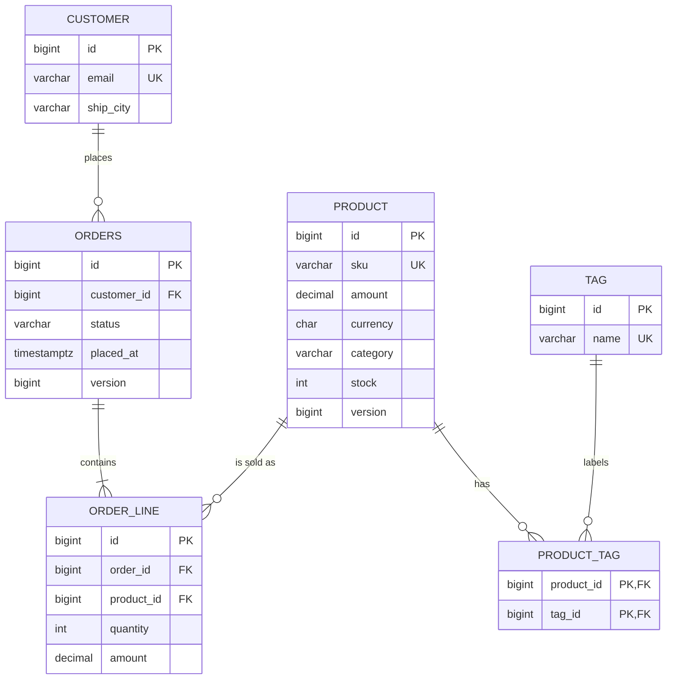

# Lab 03 - Task 1: Schema Validation Experiments

## 1. Renaming `sku` to `code` in `V1__init.sql`
Error message recorded when Hibernate validates the schema:
org.hibernate.tool.schema.spi.SchemaManagementException: Schema-validation: missing column [sku] in table [product]

## 2. Changing Sequence Increment to 1 (`INCREMENT BY 1`)
Error message recorded when Hibernate checks sequence parameters against `allocationSize = 50`:
org.hibernate.tool.schema.spi.SchemaManagementException: Schema-validation: sequence [product_seq] increment size mismatch; found [1], expected [50]

# Lab 3 – Task 3: Repositories, Queries, Projections and Paging

Project: `edu.itc.se:shop-jpa` (Spring Boot, Spring Data JPA)

## What I built

- Spring Data repositories for Customer, Product and Order
- Derived queries, JPQL queries (with join fetch), and one native query
- Projections: an interface projection and a record projection
- A search with Specifications (optional filters)
- A data seeder for the `dev` profile
- Three REST endpoints with paging and sorting
- Tests with `@DataJpaTest`

## Project structure

```
src/main/java/edu/itc/se/shop_jpa/
├── domain/        entities (from Lab 1 and 2)
├── repository/    CustomerRepository, ProductRepository,
│                  OrderRepository, ProductSpecs
├── service/       ProductService, CustomerOrderService
├── seed/          DataSeeder
└── web/           OrderController, ProductController, CustomerController
    └── dto/       OrderSummary, ProductView, OrderDto, OrderLineDto

src/test/java/edu/itc/se/shop_jpa/repository/
└── OrderRepositoryTest
```

## Queries

| Type | Method |
|------|--------|
| Derived | `findByCustomerEmailAndStatusOrderByPlacedAtDesc`, `countByStatus`, `findFirstByCustomerIdOrderByPlacedAtDesc` |
| Derived | `existsBySku`, `findTop3ByCategoryOrderByPriceAmountDesc`, `findByTagsName` |
| JPQL | `findWithLinesByCustomerEmail` (uses `join fetch`) |
| JPQL | `countLinesByStatus` (uses `count`) |
| Native | `findLowStock(int min)` |

## Projections

- `OrderSummary` is an interface projection with a nested `CustomerName`. It selects only `id`, `status`, `placed_at` and the customer `name`.
- `ProductView` is a record projection. `findByCategory` uses a `@Query` constructor expression, because the record field `amount` does not match a direct property of `Product` (the entity has `price.amount`).

## Specifications

`ProductSpecs.filter(q, category, maxPrice, inStock)` uses `Specification.allOf`. Only the filters that are not `null` are applied.

## Endpoints

| Endpoint | Returns |
|----------|---------|
| `GET /api/orders?status=PAID&page=0&size=5&sort=placedAt,desc` | `Page<OrderSummary>` |
| `GET /api/products?q=&category=&maxPrice=&inStock=&page=&size=` | `Page<ProductView>` |
| `GET /api/customers/{email}/orders` | `List<OrderDto>` (with lines) |

No controller returns an entity. The customer endpoint runs inside a `@Transactional(readOnly = true)` service method.

## How to run

Start the app with the `dev` profile (this runs the seeder):

```powershell
./mvnw spring-boot:run "-Dspring-boot.run.profiles=dev"
```

Run the tests:

```powershell
./mvnw -q test -Dtest=OrderRepositoryTest
```

The HTTP calls and their responses are in `api-session.md`.

## Tests (OrderRepositoryTest)

1. Derived query returns the newest order first
2. Fetch join: `Hibernate.isInitialized(order.getLines())` is `true` after the query, and `false` after a plain `findById` + `clear`
3. Native query `findLowStock`
4. Interface projection with nested customer name
5. `countByStatus` and `countLinesByStatus`

## Typo exercise: boot error

I changed a method name to `findByCustomerEmali...` and started the app. Spring Data reads every repository method at startup, so the app failed to boot.

Error:

```
PASTE YOUR REAL BOOT ERROR HERE
```

It looks something like this:

```
Caused by: org.springframework.data.core.PropertyReferenceException:
No property 'emali' found for type 'Customer'; Did you mean 'email'?
```

**What I learned:** derived query names are checked at startup, not when the method is called. A wrong property name stops the app right away. I fixed the typo after this test.

## What I learned

- Derived queries save a lot of code, but long names get hard to read. Use `@Query` then.
- `join fetch` loads the lines in one query, so there is no N+1 problem.
- Interface projections select only the columns they need. I checked this in the SQL log.
- Specifications let me combine optional filters without writing many query methods.

## Task 5: N+1 and performance tuning

The query-counter test seeds 50 paid orders. Batch size is set per service method so the naive case is not accidentally optimized by the batched case.

| Variant | Statement count | Notes |
|--------|----------------:|-------|
| naive lazy loop | 51 | One order query plus one lazy lines query per order |
| join fetch | 1 | one query loads orders and lines together |
| entity graph | 1 | one fetch-graph query loads the required association |
| batch fetch (16) | 5 | one order query plus four collection batches |

Run with `./mvnw -q -Dtest=NPlusOneTest test`.

## Challenge: reporting, scrolling, reservations, and bulk import

### Product report API

`GET /api/reports/products?q=&category=&maxPrice=&minStock=&tag=&sort=` returns `ProductReportRow(sku, name, amount, stock, tagCount)` records. `q` searches the lower-cased product name and SKU; every other filter is optional. Only `sku`, `name`, `amount`, `stock`, and `tagCount` are accepted as sort fields, and direction is `asc` or `desc`. Invalid sort input returns HTTP 400. The repository fragment uses `CriteriaBuilder` and generated `Product_`, `Money_`, and `Tag_` metamodel classes. The tag association join is created only when the tag filter is present; tag count is a correlated subquery.

```sh
curl -s 'localhost:8080/api/reports/products?category=HARDWARE&minStock=1&tag=sale&sort=amount,desc'
```

### Order feed

The Slice cursor endpoint is `GET /api/orders/feed?size=20&after=<placedAt>,<id>`. The first request omits `after`; the next request passes `nextCursor`. The keyset equivalent is `GET /api/orders/feed/keyset?size=20&after=<placedAt>,<id>`. Both return `{ items, nextCursor, hasNext }`; the feed has a maximum size of 100.

The Slice method uses an ordered `Slice<OrderSummary>` and the explicit cursor predicate. Hibernate SQL (H2 dialect; parameters shown as `?`):

```sql
select o1_0.id,o1_0.status,o1_0.placed_at
     ,c1_0.id,c1_0.street,c1_0.city,c1_0.zip,c1_0.email,c1_0.name,
      c1_0.ship_street,c1_0.ship_city,c1_0.ship_zip
from orders o1_0
left join customer c1_0 on c1_0.id=o1_0.customer_id
where o1_0.placed_at < ?
   or (o1_0.placed_at = ? and o1_0.id < ?)
order by o1_0.placed_at desc,o1_0.id desc
fetch first ? rows only
```

The keyset method returns `Window<Order>` and passes `ScrollPosition.keyset()` on its first request, then the keyset in `after`:

```sql
select o1_0.id,o1_0.customer_id,o1_0.placed_at,o1_0.status,o1_0.version
from orders o1_0
where 1=1
  and (o1_0.placed_at < ? or o1_0.placed_at = ? and o1_0.id < ?)
order by o1_0.placed_at desc,o1_0.id desc
fetch first ? rows only
```

Keyset scrolling does not use `OFFSET 100000`: it seeks from the last `(placed_at,id)` tuple, so the database does not read and discard all earlier rows. `V4__report_and_feed_indexes.sql` adds the matching `(placed_at DESC,id DESC)` index. Slice is easy to integrate with Spring paging abstractions; keyset is the better choice for a long-running feed.

### Stock reservations

`StockService.reserve` locks the product row with `PESSIMISTIC_WRITE`. `reserveOptimistically` uses the `Product.version` field and retries optimistic conflicts; `reserveAtomically` executes a conditional update that decrements only while enough stock remains. All three are tested with ten simultaneous workers against stock five. The schema check and final stock assertion ensure the value cannot become negative.

Measured in one local H2 run (10 calls; results vary by machine and scheduling):

| Strategy | Success / out of stock | Time | Approx. throughput |
|----------|------------------------|-----:|-------------------:|
| Pessimistic row lock | 5 / 5 | 9 ms | 1,111 calls/s |
| Optimistic version + retry | 5 / 5; 26 retries | 6 ms | 1,667 calls/s |
| Conditional atomic update | 5 / 5 | 13 ms | 769 calls/s |

`V3__product_version.sql` adds the version column without editing the already-applied V1 or V2 migrations. Use `./mvnw -q -Dtest=StockReservationTest test` to rerun the concurrent test.

### Bulk catalogue import

The input format is `sku;name;amount;currency;category;stock`. `BulkImportService.importCsv` streams the file, parses chunks of 500, and calls Hibernate 7 `StatelessSession.insertMultiple` with JDBC batching. The alternatives use Spring Data `saveAll` in one transaction, either keeping the persistence context or flushing and clearing every 500 rows.

One 50,000-row sample run (Java 27 runtime, H2 in-memory; SQL logging disabled for a meaningful timing):

| Strategy | Wall time | Sampled peak heap increase |
|----------|----------:|---------------------------:|
| StatelessSession, batch 500 | 580 ms | 232 MiB |
| `saveAll`, one transaction, no clear | 729 ms | 98 MiB |
| `saveAll` + flush/clear every 500 | 365 ms | 171 MiB |

These are local measurements, not fixed performance guarantees. Heap is sampled while the test runs and includes the in-memory H2 database and JVM allocation behavior. The test verifies 50,000 imported rows for each strategy and enforces the under-10-second StatelessSession target. Run `./mvnw -q -Dtest=BulkImportTest test`.

### Schema diagram

The application has these six related tables:



Flyway history remains append-only: V1 defines the six tables, V2 adds the earlier customer/order/product indexes, V3 adds `product.version` for optimistic reservations, and V4 adds the feed-cursor and reverse tag-lookup indexes. No applied migration was rewritten.

### Repository method to SQL reference

The following are normalized SQL shapes captured from Hibernate SQL logging during the integration tests. `?` denotes a bound parameter; a paged method may also issue a separate count query.

| Repository method | SQL Hibernate generates |
|---|---|
| `CustomerRepository.findByEmail` | `select c.id,... from customer c where c.email=?` |
| `ProductRepository.existsBySku` | `select case when count(p.id)>0 then true else false end from product p where p.sku=?` |
| `ProductRepository.findTop3ByCategoryOrderByPriceAmountDesc` | `select p.* from product p where p.category=? order by p.amount desc fetch first 3 rows only` |
| `ProductRepository.findByTagsName` | `select p.* from product p join product_tag pt on p.id=pt.product_id join tag t on t.id=pt.tag_id where t.name=?` |
| `ProductRepository.findLowStock` | `select p.* from product p where p.stock < ? order by p.stock` |
| `ProductRepository.findByCategory` | `select p.id,p.sku,p.name,p.amount,p.currency,p.stock,p.version from product p where p.category=? offset ? rows fetch first ? rows only` |
| `ProductRepository.findProductReport` | `select p.sku,p.name,p.amount,p.stock,(select count(t.id) from tag t where exists(select 1 from product_tag pt where t.id=pt.tag_id and pt.product_id=p.id)) from product p [join product_tag and tag only with tag filter] where [optional predicates] group by p.id,p.sku,p.name,p.amount,p.stock order by [whitelisted expression]` |
| `ProductRepository.findForUpdate` | `select p.* from product p where p.id=? for update` |
| `ProductRepository.reserveStockAtomically` | `update product set stock=stock-?,version=version+1 where id=? and stock>=?` |
| `ProductRepository.findAll(specification,pageable)` | `select p.* from product p where [name/category/amount/stock predicates that are present] order by [page sort] offset ? rows fetch first ? rows only` |
| `OrderRepository.findByCustomerEmailAndStatusOrderByPlacedAtDesc` | `select o.* from orders o join customer c on c.id=o.customer_id where c.email=? and o.status=? order by o.placed_at desc` |
| `OrderRepository.findByStatus` | `select o.* from orders o where o.status=?` |
| `OrderRepository.countByStatus` | `select count(o.id) from orders o where o.status=?` |
| `OrderRepository.findFirstByCustomerIdOrderByPlacedAtDesc` | `select o.* from orders o where o.customer_id=? order by o.placed_at desc fetch first 1 row only` |
| `OrderRepository.findByStatus(status,pageable)` | `select o.id,o.status,o.placed_at,c.name from orders o join customer c on c.id=o.customer_id where o.status=? order by o.placed_at desc offset ? rows fetch first ? rows only` plus `select count(o.id) from orders o where o.status=?` |
| `OrderRepository.findAllBy(pageable)` | `select o.id,o.status,o.placed_at,c.* from orders o left join customer c on c.id=o.customer_id order by o.placed_at desc,o.id desc fetch first ? rows only` |
| `OrderRepository.findFeedAfter` | `select o.id,o.status,o.placed_at,c.* from orders o left join customer c on c.id=o.customer_id where o.placed_at<? or (o.placed_at=? and o.id<?) order by o.placed_at desc,o.id desc fetch first ? rows only` |
| `OrderRepository.findByStatusWithLines` | `select o.*,l.*,p.* from orders o left join order_line l on o.id=l.order_id left join product p on p.id=l.product_id where o.status=?` |
| `OrderRepository.findWithGraphByStatus` | `select o.* from orders o left join order_line l on l.order_id=o.id left join product p on p.id=l.product_id where o.status=?` |
| `OrderRepository.findWithLinesByCustomerEmail` | `select distinct o.* from orders o join customer c on c.id=o.customer_id join order_line l on l.order_id=o.id join product p on p.id=l.product_id where c.email=? order by o.placed_at desc` |
| `OrderRepository.countLinesByStatus` | `select count(l.id) from order_line l join orders o on o.id=l.order_id where o.status=?` |
| `OrderRepository.findBy(specification,scroll)` | `select o.* from orders o where 1=1 and (o.placed_at<? or o.placed_at=? and o.id<?) order by o.placed_at desc,o.id desc fetch first ? rows only` |
| `TagRepository` inherited `findById` / `existsById` | `select t.* from tag t where t.id=?` / `select case when count(t.id)>0 then true else false end from tag t where t.id=?` |

The remaining inherited repository operations map to these SQL forms for their entity:

| Inherited repository method | SQL Hibernate generates |
|---|---|
| `findById`, `getReferenceById`, `getById`, `getOne` | `select e.* from <table> e where e.id=?` (`getReferenceById` may defer the select until state is accessed) |
| `findAll`, `findAll(Sort)`, `findAll(Pageable)` | `select e.* from <table> e [order by ...] [offset ? rows] [fetch first ? rows only]` |
| `findAllById` | `select e.* from <table> e where e.id in (?,...,?)` |
| `existsById`, `count` | `select case when count(e.id)>0 then true else false end from <table> e where e.id=?` / `select count(e.id) from <table> e` |
| `save`, `saveAll`, `saveAndFlush`, `saveAllAndFlush` | new entity: `select next value for <sequence>` then `insert into <table> (...) values (...)`; existing versioned entity: `update <table> set ...,version=? where id=? and version=?` |
| `deleteById`, `delete`, `deleteAllById`, `deleteAll` | `delete from <table> where id=?` (entity deletes may first select the entity) |
| `deleteAllInBatch`, `deleteAllByIdInBatch` | `delete from <table> [where id in (?,...,?)]` |
| `flush` | executes pending `insert`, `update`, and `delete` statements in the persistence context |

Hibernate may rewrite aliases, add columns required by a projection, or use dialect-specific pagination; the table records the SQL shape, not generated alias names.